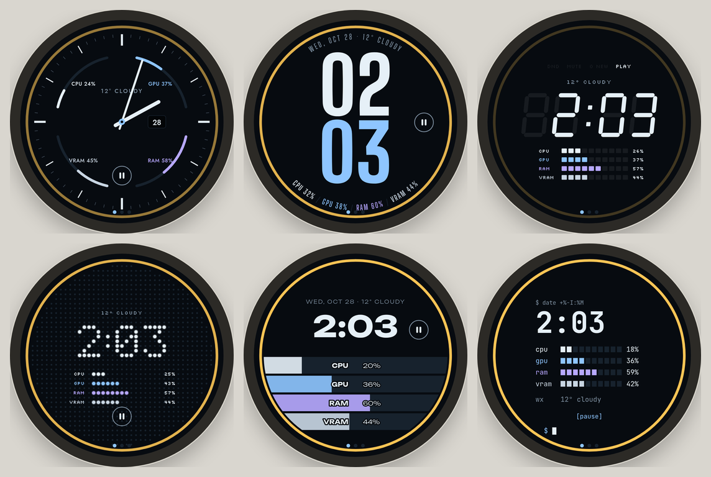
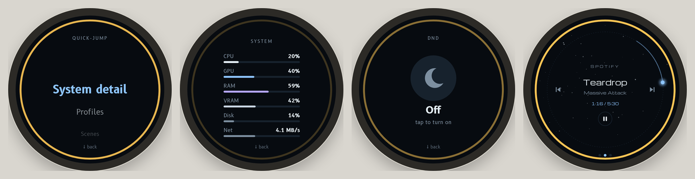
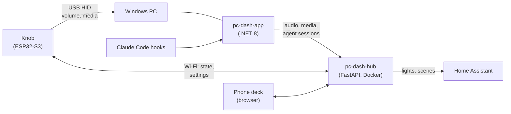

# PC Dash Knob

[](https://github.com/btkramer/lilygo-rotary-knob/actions/workflows/build.yml)


Firmware for a desktop rotary-knob controller built on the **LilyGo T-Encoder Pro**: a round
2" AMOLED touchscreen inside a rotary encoder. It controls PC volume and media natively over
USB, shows what's playing, and glows when a Claude Code session needs your attention.


<sub>Screens from the interactive v2 design prototype; the orange ring means a Claude Code session is working.</sub>

Part of the **PC Dash** family:

| Repo | Role |
|---|---|
| **lilygo-rotary-knob** (this repo) | The knob: ESP32-S3 firmware |
| [pc-dash-hub](https://github.com/btkramer/pc-dash-hub) | Self-hosted hub (FastAPI + Docker) that relays state, settings and smart-home actions |
| [pc-dash-app](https://github.com/btkramer/pc-dash-app) | Windows companion app that reports real PC audio, media and agent state |

## Design directions

The v2 screens were explored in an interactive prototype with eight visual directions. Each
one has its own type, palette and layout for Home, Now Playing and Light:





<sub>Top: Analog, Typeset, Segment LCD, Dot matrix, Stripes, Terminal. Bottom: Quick-jump, System detail, Do Not Disturb, Now Playing (Orbit).</sub>

## The PC Dash system



## Features

- **USB HID first**: volume, mute, play/pause and previous/next are sent as standard USB
  consumer-control keys. There are no drivers, it works at the lock screen, and it needs no app
  or network
- **Screens**: Home (clock), Volume overlay, Speaker Mute, Now Playing (title, artist and a
  touch transport row with tap-glow feedback) and a Quick-jump menu
- **Gesture vocabulary**: turn, press, long-press, tap and swipe, tuned for a half-step encoder
- **Agent-monitor mode**: a glanceable status badge and ring for Claude Code sessions. It turns
  orange while an agent is working and flashes when a session changes state. The feed comes
  from the hub and is hidden automatically when it goes stale
- **Synced settings** with the hub: adaptive polling on its own FreeRTOS task, persisted in NVS
- Graceful degradation: when the companion app or the hub is offline, the knob falls back to
  local placeholders instead of breaking
- **OTA updates** (ArduinoOTA and HTTP)

## Hardware

| | |
|---|---|
| Board | LilyGo T-Encoder Pro: ESP32-S3R8, 16 MB flash, 8 MB PSRAM |
| Display | 2.04" round AMOLED, 390×390, QSPI (CO5300 driver variant) |
| Touch | CST816 capacitive |
| Input | Half-step rotary encoder with push; buzzer |

## Building

Uses PlatformIO with LVGL 9.2, Arduino_GFX, SensorLib and ArduinoJson 7.

```sh
cp include/secrets.h.example include/secrets.h   # Wi-Fi, OTA password, hub IP
pio run -e usb -t upload                          # first flash over USB
OTA_PASSWORD=... pio run -e ota -t upload         # later, over Wi-Fi
```

## Code layout

`src/main.cpp` holds only `setup()` and `loop()`. Each module is a `src/<name>.cpp` with its
declarations in `include/<name>.h`:

| Module | Responsibility |
|---|---|
| `input` | Encoder interrupt, the global interaction clock, CST816 touch and LVGL's touch read |
| `hid_media` | USB HID consumer-control device (volume, mute, media keys) |
| `display` | CO5300 AMOLED panel, LVGL buffers/flush/tick, brightness levels, `setupLVGL()` |
| `screen_nav` | Shared screen objects, return-screen state, `restoreScreen()`, screen timeouts, swipe gestures |
| `screen_home` | Home screen: CPU/GPU/RAM ring gauges |
| `screen_volume` | Volume overlay |
| `screen_mute` | Speaker-mute overlay |
| `screen_now_playing` | Now Playing and its HID transport controls |
| `screen_quick_jump` | Quick-jump grid |
| `screen_idle` | Burn-in-safe idle clock/date screen |
| `agent_status` | Claude Code agent-monitor status: aggregate state, Home badge, flash and global ring |
| `buzzer` | Non-blocking buzzer patterns and the attention chime |
| `pc_state` | Live PC state synced from the hub (temperatures, `pcConnected`, last input) |
| `hub_sync` | pc-dash-hub polling task: state, settings and agent sessions, handed to `loop()` |
| `settings_store` | NVS persistence of synced settings; starts the sync task |
| `wifi_ota` | Wi-Fi connect, ArduinoOTA and SNTP time |
| `http_ota` | HTTP firmware upload, `/restart` and temporary `/debug` endpoints |
| `debug_console` | Boot reset-reason diagnostic and the WebSerial console |

## Status

All the original screens are built and verified on hardware, along with HID control and
agent-monitor mode. A phone macro deck and deeper cross-device features are being designed.
