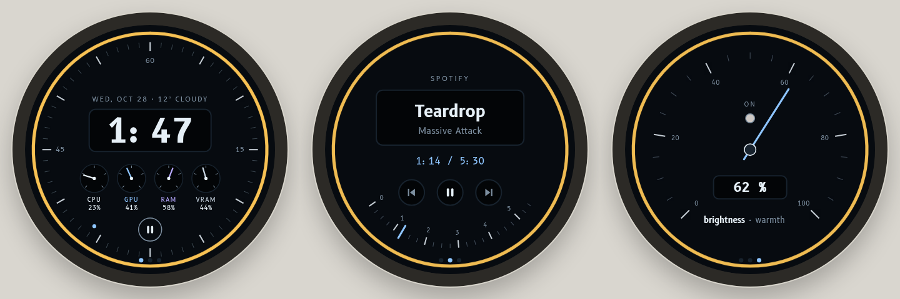

# PC Dash Knob

Firmware for a desktop rotary-knob controller built on the **LilyGo T-Encoder Pro**: a round
2" AMOLED touchscreen inside a rotary encoder. It controls PC volume and media natively over
USB, shows what's playing, and glows when a Claude Code session needs your attention.



<sub>Screens from the interactive v2 design prototype; the orange ring means a Claude Code session is working.</sub>

Part of the **PC Dash** family:

| Repo | Role |
|---|---|
| **lilygo-rotary-knob** (this repo) | The knob: ESP32-S3 firmware |
| [pc-dash-hub](https://github.com/btkramer/pc-dash-hub) | Self-hosted hub (FastAPI + Docker) that relays state, settings and smart-home actions |
| [pc-dash-app](https://github.com/btkramer/pc-dash-app) | Windows companion app that reports real PC audio, media and agent state |

## Features

- **USB HID first**: volume, mute, play/pause and previous/next are sent as standard USB
  consumer-control keys. There are no drivers, it works at the lock screen, and it needs no app
  or network
- **Screens**: Home (clock), Volume overlay, Speaker Mute, Now Playing (title, artist and a
  touch transport row with tap-glow feedback) and a Quick-jump menu
- **Gesture vocabulary**: turn, press, long-press, tap and swipe, tuned for a half-step encoder
- **Agent-monitor mode**: a glanceable status badge and ring for Claude Code sessions. It turns
  orange while an agent is working and flashes when a session changes state. The feed comes
  from the hub and is hidden automatically when it goes stale
- **Synced settings** with the hub: adaptive polling on its own FreeRTOS task, persisted in NVS
- Graceful degradation: when the companion app or the hub is offline, the knob falls back to
  local placeholders instead of breaking
- **OTA updates** (ArduinoOTA and HTTP)

## Hardware

| | |
|---|---|
| Board | LilyGo T-Encoder Pro: ESP32-S3R8, 16 MB flash, 8 MB PSRAM |
| Display | 2.04" round AMOLED, 390×390, QSPI (CO5300 driver variant) |
| Touch | CST816 capacitive |
| Input | Half-step rotary encoder with push; buzzer |

## Building

Uses PlatformIO with LVGL 9.2, Arduino_GFX, SensorLib and ArduinoJson 7.

```sh
cp include/secrets.h.example include/secrets.h   # Wi-Fi, OTA password, hub IP
pio run -e usb -t upload                          # first flash over USB
OTA_PASSWORD=... pio run -e ota -t upload         # later, over Wi-Fi
```

## Status

All the original screens are built and verified on hardware, along with HID control and
agent-monitor mode. A phone macro deck and deeper cross-device features are being designed.
